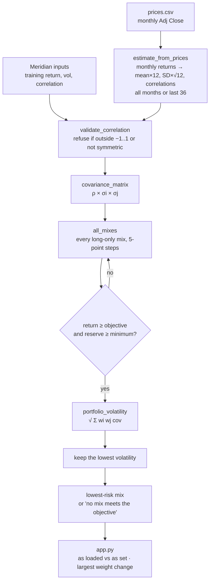

# Lab 15 — Portfolio Stability Decision

**Author:** Drew Scheiderer · **Date:** 2026-10-22 · **Cases:** Meridian Foundation Reserve
(fictional, course training values) and my Project 2 practice universe (BIL / IEF / LQD / VT)

**Question (D):** Which mix carries the least risk while meeting the mandate, and does the answer
survive a one-point change in one estimate?

**Files:** [`portfolio.py`](portfolio.py) (Lab 14 engine plus `lowest_risk_mix` and
`estimate_from_prices`) · [`app.py`](app.py) · [`prices.csv`](prices.csv) ·
Lab 14 write-up [`Meridian_2026-10-20_lab14.md`](Meridian_2026-10-20_lab14.md)

**Run** (from this folder, with the project `.venv` active): `python portfolio.py` prints the
Lab 14 baselines, unchanged. `streamlit run app.py` opens the app.

---

## Explain to my partner first (no screen)

> **TODO (Drew):** your universe, objective and one hard constraint, and what your partner wrote
> down. Swap.

## R — my universe and my mandate

| Input | Meridian (training) | Mine |
|---|---|---|
| Assets | bills, 10-year, IG bond fund, global equity | BIL, IEF, LQD, VT |
| Return, volatility, correlation | Lab 14 training tables | `estimate`, from 59 monthly returns (prices 2021-10-01 to 2026-09-01) |
| Objective | 6.5% expected return | 6.5% expected return (CPI 2.5% *estimate* + 4%) |
| Hard constraint | reserve-eligible weight ≥ 3% (bills + 10-year) | reserve-eligible weight ≥ 3% (BIL only) |

**Prices.** Monthly Adj Close from Yahoo Finance via `yfinance` 1.7.0 (`auto_adjust=True`),
downloaded **2026-10-22**. Fund names, roles and the reason only BIL counts as reserve are in the
[Lab 14 write-up](Meridian_2026-10-20_lab14.md#before-thursday--my-project-2-universe-in-funds).

**Draw my engine first (paper, no AI).**

> **TODO (Drew):** draw it on paper and show your partner. Compare it with the Mermaid chart below.

## I — the app

Built from the Lab 15 instruction with Claude Code. `app.py` imports the engine's functions and
Meridian's inputs from `portfolio.py`, and holds no copy of the math.

- **Sidebar:** objective (starts at 6.5%), reserve minimum (starts at 3%), `prices.csv` upload,
  last-36-months switch.
- **Page:**
  - an editable expected-return box for each asset;
  - a reserve-eligible tick box for each asset;
  - the lowest-risk mix beside the answer for the inputs as loaded;
  - the largest weight change, in points.
- **Search:** every long-only mix in 5-point steps (1,771 mixes for four assets). It keeps the
  mixes whose return ≥ objective and whose reserve weight ≥ minimum, and returns the
  lowest-volatility one, or "no mix meets the objective".
- **Estimate:** monthly simple returns from prices. Annual return = mean × 12; volatility =
  SD × √12; correlations from monthly returns. Checked against pandas to within 1e-9.

## V — proof on the known answer

| Run | Bills / 10-year / IG / equity | Return | Volatility | Course answer |
|---|---|---:|---:|---|
| As loaded | 0 / 20 / 25 / 55 | 6.51 | 9.44 | ✓ |
| Equity return box 8.0 → 7.0 | 0 / 10 / 10 / 80 | 6.53 | 12.94 | ✓ |

**Largest weight change: 25 points** (equity 55 → 80). One point off one estimate moves a quarter
of the money.

**Prove it is my engine.** I set the IG–equity correlation in `portfolio.py` to 0.50. The engine
gives **0 / 40 / 0 / 60 at 6.52 and 9.73**, which matches. I set it back to 0.25.

> **TODO (Drew, in class):** repeat this in the browser. Edit `portfolio.py`, save, refresh the
> page, see 0 / 40 / 0 / 60, then set it back.

`python portfolio.py` still prints the Lab 14 values, byte-for-byte identical to
[`output/Meridian_2026-10-20_lab14_portfolio.txt`](output/Meridian_2026-10-20_lab14_portfolio.txt).

## My universe

Objective 6.5%, reserve minimum 3%, only BIL ticked. All returns are **estimates** (history, not
forecast).

| Window | Return estimate: BIL / IEF / LQD / VT | Volatility: BIL / IEF / LQD / VT |
|---|---|---|
| All months (59) | 3.66 / (1.73) / (0.93) / 11.05 | 0.49 / 7.72 / 9.87 / 14.92 |
| Last 36 months | 4.37 / 3.07 / 4.84 / 20.25 | 0.21 / 6.66 / 7.82 / 11.71 |

| Window | Lowest-risk mix: BIL / IEF / LQD / VT | Return | Volatility | Reserve |
|---|---|---:|---:|---:|
| All months | **60 / 0 / 0 / 40** | 6.61 | 6.05 | 60.0 |
| Last 36 months | **85 / 0 / 0 / 15** | 6.75 | 1.79 | 85.0 |

**Largest weight change: 25 points** (VT 40 → 15, BIL 60 → 85), from changing only the estimation
window.

**What the numbers say:**
- The bond funds get zero weight in both windows. Over all months, their average returns are
  negative because the window starts just before the 2022 rate hikes.
- Over the last 36 months, IEF's 0.94 correlation with LQD and LQD's 0.69 with VT mean they add
  little diversification beyond BIL.
- The last-36 equity estimate of 20.25% a year comes from a strong bull run, not something to
  expect going forward. Because of it, only 15% in VT is enough to reach 6.5% on paper.
- BIL's 0.21% volatility and the reserve rule do the rest.

## Explain the code (no AI)

> **TODO (Drew):** explain `lowest_risk_mix` in `portfolio.py` to your partner line by line, and
> record their question and your answer.

## Partner attack

> **TODO (Drew):** your partner moves the estimate they distrust most and reads the answer aloud.
> Record what they moved, what the app showed, and your two-sentence answer.

## My call

> **TODO (Drew):** adopt, pilot or reject the app's mix as your Project 2 starting allocation,
> plus the condition that would change it. Tie it to the stress result: the 25-point move from
> the window change.

## Estimation risk — learn on my own

> **TODO (Drew):** 1. What is it? 2. Why does an optimizer amplify small errors in expected
> returns? 3. Explain it with your own largest weight change (25 points).

## Reflect

> **TODO (Drew):** 1. Why did the lowest-risk mix move so far? 2. What would you need to see
> before you adopted it?

---

*This is a learning exercise on a fictional, course-authored case and a practice fund universe.
It is not investment advice. AI assistance: the search and estimation functions in
`portfolio.py`, `app.py`, the Mermaid chart, the price download and the factual sections of this
write-up were produced with Claude Code (Claude Opus 5.5). I checked them against the course's
known answers. I chose the universe, objective and constraint. The partner, no-AI, call and
reflection sections are my own. Any remaining errors are my own.*
